### Introduction

At Darwin, my main focus was building systems that could conduct AI research autonomously. The core idea is to take a research objective, say creating a model to predict how proteins fold, and instead of coming up with the architecture, tuning hyperparameters, running ablations, debugging training runs, and iterating on it by hand, you let AI agents propose ideas, write programs, run experiments, and read the results to try and solve it. 

Each experiment builds on the best one so far, eventually **“hillclimbing”** towards a model that reaches the frontier. Untraditionally, this is not gradient descent but [gradient-free optimization](https://en.wikipedia.org/wiki/Derivative-free_optimization), where no gradient can be calculated to point toward an optimum.

<figure class="blog-figure" data-figure="climb">

<canvas aria-label="Experiments land one at a time and most score below the best so far. A gold line steps up each time one beats it, until it crosses the frontier"></canvas>

</figure>

This can have numerous implications such as accelerated drug discovery or solving hard computational biology problems like [RNA folding](https://www.sciencedirect.com/topics/neuroscience/rna-folding) or the [virtual cell](https://virtualcellchallenge.org/), potentially resulting in the next AlphaFold. In theory, with an autonomous AI R&D system, you could be automating parts of scientific discovery itself.

Keep in mind, before this internship, I had no experience with autonomous AI research or gradient-free optimization using LLMs!

### Background

Autoresearch is a field that grows faster every day, so here is some quick background knowledge to understand part of what I was building. A lot of autoresearch is based on something called **evolutionary computation (EC)**.

Inspired by biology, it uses **evolutionary algorithms (EAs)**, which treat candidate solutions as organisms that compete to survive and reproduce, and in doing so can traverse combinatorial search spaces and progressively "hillclimb" toward the optimal solution. Turing ideated evolutionary search as a path toward machine intelligence in 1950, and by the '60s and '70s it had become a working method ([Turing 1950](https://doi.org/10.1093/mind/LIX.236.433), [Bäck et al. 1997](https://doi.org/10.1109/4235.585888)).

In early EAs, candidates were proposed through low-level mutations such as flipping a bit or nudging a parameter. That works on simple encodings like bit-strings, but not on code, where random perturbations in syntax do not produce meaningful programs.

The solution? Use the **LLM as a mutation operator**, and the variation becomes semantic. The most popular example of this is Google DeepMind's **AlphaEvolve** ([Novikov et al. 2025](https://arxiv.org/abs/2506.13131)), which found a way to multiply 4×4 complex matrices in only 48 scalar multiplications, the first improvement on Strassen's 1969 method in 56 years!

Formally, we are given a search space $\mathcal{X}$ and a fitness function $f$ : $\mathcal{X} \to \mathbb{R}$, and we seek:

$$x^* = \arg\max_{x \in \mathcal{X}} f(x).$$

Most EAs can roughly be outlined in a general procedure, mimicking evolutionary mechanisms of selection, reproduction, recombination, and mutation. We begin with a population of candidate solutions $P = \{x_{1}, ..., x_{\mu}\} \in \mathcal{X}$ at generation $t$, initialized by sampling $P_{0}$ at random. Then:

1. Evaluate the fitness $f(x)$ of each individual $x \in P_{t}$ in the current population.
2. Select individuals (preferably those with higher fitness) as parents $S_{t} \subseteq P_{t}$.
3. Produce $\lambda$ offspring, and for each, potentially cross over information from two or more parents (i.e., recombination).
4. Mutate each offspring via a variation operator $m$.
5. Select individuals from the parents and offspring as survivors $P_{t+1}$.

This loop is repeated until a goal is reached and termination criteria are met. There are two major parts of EAs that determine how the search behaves. Steps 3 and 4 are the **variation operators**, which include both mutation and crossover (recombination), deciding what new candidates are produced. Steps 2 and 5 are the **selection strategies**, which decide what candidates are kept and bred from.

<figure class="blog-figure" data-figure="generation">

<canvas aria-label="A population of candidate programs, taller meaning fitter, going through the five steps four times, which are evaluate, select parents, cross over, mutate, and select survivors, with the weakest cut each generation"></canvas>

</figure>

Since AlphaEvolve, systems like **ShinkaEvolve** ([Lange et al. 2025](https://arxiv.org/abs/2509.19349)), **OpenEvolve** ([Sharma 2025](https://github.com/algorithmicsuperintelligence/openevolve)), and **GEPA** ([Agrawal et al. 2025](https://arxiv.org/abs/2507.19457)) have pushed the loop in a lot of directions.

Darwin's autoresearcher roughly follows the same outline. It starts off with a population of candidate programs. Each one aims to solve the research objective. A fitness function evaluates each candidate and returns a score. Better candidates are more likely to be selected as parents, and an agent edits a parent into a child.

Sounds simple, but each step comes with its own problems. A complex evolving search like this can fail in different ways. It has no idea what has already been tried. It gets stuck and plateaus. It rediscovers and reimplements the same idea over and over. It learns to game the score and does some reward-hacking instead of solving the problem at hand.

My summer was a mix of building pieces of the autoresearcher, fixing different ways it broke, and then running it on a real competition.

### Research Engine

The largest project I worked on was giving Darwin's autoresearcher access to research papers. Most AI models answer from what they absorbed during training, and that knowledge stops at a cutoff and blurs the details. A model remembers that a method exists, not what its ablations showed. An automated researcher that has never read a paper is going to reinvent a lot of wheels, and here every reinvented wheel costs a training run.

ASI-Evolve has a small version of this result. With a handful of hand-written priors, including what earlier systems had done, the full system climbed to about the circle-packing record. Without the priors it climbed more slowly and was still short of it after 400 steps ([Xu et al. 2026](https://arxiv.org/abs/2603.29640), Fig. 5).

So I built a research engine that lets the search read actual papers and cite them while it works. It has three parts, a literature database, retrieval tools, and deep-research agents that review the literature before a run starts.

#### Literature DB

The corpus covers machine learning and robotics from arXiv, plus biology, mostly from arXiv's q-bio section with smaller hand-built sets from bioRxiv and journals for problems like RNA folding and protein function. It lives in Postgres with pgvector, the extension that adds vector columns and a nearest-neighbour index to Postgres.

A teammate scaffolded the service and a first arXiv scraper and later deployed it to the cloud. I built the pipeline in between. This was the most conventional full-stack part of the job, with TypeScript and NestJS for the service, Python for the ML pieces, and Postgres underneath.

<figure class="blog-figure" data-figure="corpus">

<canvas aria-label="One paper goes through the pipeline, from its source to parsed sections, chunks and embeddings, then the view pulls back to the whole corpus of 337,000 papers in machine learning, robotics and biology, lighting up as full text is backfilled"></canvas>

<figcaption>One paper through the pipeline, then all 337,000 of them. Machine learning is most of the corpus, then robotics and a smaller slice of biology. Gold dots have full text, which was still filling in when the summer ended.</figcaption>
</figure>

Papers arrive in two passes. The first is metadata. A scheduled scraper walks arXiv forward for new papers and backward through the archive, keeping a cursor so a crash resumes where it stopped. When rate limits slowed the backward walk to a crawl, I loaded the gap from arXiv's public metadata snapshot instead. Every paper gets a title-and-abstract embedding, so the whole corpus is searchable by meaning before any full text is parsed.

The second pass is full text. It runs as a backfill, and it was still working through the corpus when the summer ended. Parsing tries the cleanest source first. For arXiv that is the HTML arXiv generates from the LaTeX source, which keeps equations as TeX. Otherwise the PDF goes through Docling, a layout-aware parser, with MarkItDown as a fallback. bioRxiv and journal papers come as JATS, the XML format publishers use.

I chose Docling after a bakeoff on real arXiv PDFs. MarkItDown was far faster but returned flat text with no headings, and headings are what let a search go straight to a paper's methods or ablations.

Text is split at headings, then at paragraph breaks into chunks of a few hundred words, with tables kept whole. Each vector records the model that produced it, so a re-embed can run beside the old one.

I used pgvector instead of a dedicated vector database because we already ran Postgres. That meant one migration rather than another service to operate. Its HNSW index, an approximate nearest-neighbour graph, holds up well to a few million vectors, which is this corpus's range.

Two decisions came from measuring first. I checked a sample of bioRxiv papers for math. About a quarter had any display equation, and it was biology and statistics, not ML. Keeping it meant OCR at maybe 90% accuracy, so bioRxiv goes in as prose only.

Then coverage. Seeding a domain corpus from arXiv search gave me recent papers that cite the classics, but not the classics themselves. Even a query naming a method could miss the paper that introduced it. So each domain corpus now starts from a hand-checked spine of foundational papers, added by ID and grown through the citation graph. Journal-only landmarks like AlphaFold 2 and 3 have no preprint, so they came in through PubMed Central.

The long tail took real time. Docling crashed on some images, a batch of 29 papers hit edge cases, and one came out as two chunks because arXiv's own HTML for it was broken.

#### Retrieval Tools

On top of the database sit five tools the agents can call. They cover paper search, chunk search, full-paper reads, literature Q&A, and fetching a paper's code. Paper search runs two retrievers over titles and abstracts. Dense vector search matches meaning, and Postgres full-text search matches exact words.

Reciprocal rank fusion (RRF) merges the two lists by scoring each paper 1/(k + rank) in each list, so anything near the top of either survives. A cross-encoder then reorders the pool. It reads the query and each candidate together and scores the pair, which is slower than comparing vectors but much more accurate. Chunk search is dense search over body text, scoped to one paper or section on request, and also reranked.

I measured it on [LitSearch](https://arxiv.org/abs/2407.18940), a public benchmark of about 600 literature-search questions with known answer papers. Its papers sit in the same database behind a filter the agents never see, so the eval runs through production code. Hit@10 is how often a correct paper lands in the top ten. nDCG@10 also rewards ranking it higher.

| Configuration (LitSearch) | Hit@10 | nDCG@10 |
| --- | ---: | ---: |
| Keyword only (Postgres full-text search, every word must match) | 2.0% | 0.01 |
| Dense, first embedding model | 65.8% | 0.51 |
| Hybrid (first model + keyword, fused with RRF) | 64.7% | 0.48 |
| Dense, stronger embedding model | 78.1% | 0.65 |
| Stronger model + cross-encoder rerank | 82.5% | 0.71 |

The table corrects a story I used to tell. Most of the gain came from a better embedding model, and the reranker added the rest. Hybrid search did nothing on LitSearch, whose questions are long and descriptive. I kept the keyword side because dense search kept missing exact names like acronyms, benchmarks and new methods, and on a small hand-built set of those queries it fixed nearly every miss.

The cross-encoder still sets the final order, so the keyword score only widens the pool. Having a model rewrite the query several ways scored slightly below the plain query. And at full scale, pgvector's approximate index started dropping true neighbours until I widened its search, which was worth about six points of Hit@10.

Full text needed its own test, and my first one was rigged by accident. Chunks searched a couple of hundred parsed papers while abstracts searched everything. So I fixed the haystack at 5,000 LitSearch papers and changed only the representation.

Body chunks put a correct paper in the top ten 92.8% of the time, against 80.2% for abstracts, and found answers abstracts missed on 91 questions versus 16 the other way. In the live corpus that only pays off once most papers have full text. With sparse coverage, the few parsed papers crowded out better matches.

The coding agent uses these tools while it writes candidates, and cites a paper by arXiv ID or DOI when a change rests on one. Literature Q&A is a small agent in its own process. It splits the question, searches, reads, and returns one cited answer, dropping any citation it never retrieved, and the papers it reads stay out of the coding agent's context.

#### Deep Research Agents

Before the engine starts on a problem, it can run a deep-research pass over that corpus. It is modeled on [Anthropic's multi-agent research approach](https://www.anthropic.com/engineering/multi-agent-research-system). My first version was a single pass, with two fixed queries, one retrieval and one synthesis call. Its briefs read well but leaned on the model's memory and on abstracts. The rebuild splits the work into roles that check each other.

A **planner** turns the task into facets. Most come from a fixed checklist every review covers, from how the problem is framed to known failure modes, and a few are specific to the task. Its queries name problems, not methods, so the corpus has to supply the methods instead of the model's memory.

Each facet gets an **explorer** and a **verifier**, and all facets run in parallel. The explorer sweeps the corpus, runs one search ranked by citations per year to surface the canonical paper that relevance tends to bury, and one for recent work. Then it reads the methods, appendix and ablation sections of the best few papers and extracts each reusable idea with a verbatim quote.

The verifier tries to refute each idea against its cited passage and marks it supported, partial or unsupported. A claim like "X beats Y" also gets a search for counter-evidence.

A **critic** then looks for kinds of ideas the passages imply but nobody extracted, looping until nothing new turns up. A consolidation step merges duplicates, and a **synthesizer** writes the brief, covering the frontier, failure modes, contested findings and open gaps.

<figure class="blog-figure" data-figure="agents">

<canvas aria-label="The deep-research pass. A planner fans out into four directions, explorers read papers along each in parallel, verifiers check every find against its source and strike one, a critic pulls in a paper nobody opened, and a synthesizer files the rest under known, contested and open"></canvas>

<figcaption>The deep-research pass runs before the engine starts coding. It plans research directions, explores them in parallel, verifies claims against their sources, looks for what was missed, and then writes one cited brief of what is known, what is contested, and what is still open.</figcaption>
</figure>

Most of that shape came from failures. Explorers kept finding the same method under different names, which bloated the brief. The fix was a pass where the model only groups ideas by number and code does the merge, so it can't invent or drop a citation. Early briefs promoted single-paper claims to the frontier, so now a claim is stated flatly only if it is supported and backed by more than one paper.

The critic's finds used to skip verification and come out labeled as gaps in the corpus, which on practice runs sent us hunting for papers we already had. They go through the verifier now.

The review also takes minutes, so it runs alongside data preparation instead of in front of it, under a time budget that can cut exploration short but never the synthesis.

To evaluate it, every paper ID a role retrieves is captured at the tool boundary. Each run then reports two numbers. One is the share of citations pointing at papers actually retrieved that run, not recalled from memory. The other is the share backed by a full-text passage rather than an abstract.

I also used a **canary**. Self-distillation matters for RNA folding and no prompt mentions it, so I checked whether the review found it on its own, and how many papers it found behind it. On a larger corpus, the same task came back with the same number of ideas but far more distinct papers behind them.

In one run it produced 92 distinct ideas across 9 facets in about 15 minutes, every one cited to a real paper (100% cited, 96% to full text). The output separates what is well-supported from what is contested or still an open gap, so the search knows where the real frontier is.

<figure class="blog-figure" data-figure="reading">

<canvas aria-label="Papers scrolling past while highlighted passages are pulled into a landscape of ideas across nine facets"></canvas>

<figcaption>Papers stream through the deep-research pass. Passages get pulled into one landscape across nine facets, each idea marked well-supported, contested, or an open gap, until all 92 are placed and cited.</figcaption>
</figure>

### Exploration vs. Exploitation

Exploration versus exploitation is one of the oldest trade-offs in search. **Exploitation** means refining what already works, taking the best candidate so far and making it a little better. **Exploration** means trying something genuinely different, which might score worse now but could lead somewhere better. Lean too hard on exploitation and the search climbs the nearest hill and gets stuck on top of it. Lean too hard on exploration and it never improves anything long enough to win.

Most search methods turn this into a dial. A common way to pick parents is to sample them by fitness, softened by a temperature $\tau$,

$$p(x_i) = \frac{e^{f(x_i)/\tau}}{\sum_j e^{f(x_j)/\tau}}.$$

A low $\tau$ almost always picks the best candidate, which is pure exploitation, and a high $\tau$ picks nearly at random, which is pure exploration.

An autoresearcher feels this trade-off sharply. Every candidate costs a full training run, so wasted exploration is expensive. LLM agents also have a strong pull toward the same familiar ideas, so left alone the search exploits by default. A lot of my work on the search side was about keeping that balance.

#### Starting Apart

The main tool for keeping that balance is **islands**. Instead of one population, the search runs several separate populations of candidates that each evolve on their own and only now and then trade their best candidates, which is called **migration**.

<figure class="blog-figure" data-figure="islands">

<canvas aria-label="Four island populations of candidate programs evolving in parallel, with the best migrating between islands"></canvas>

<figcaption>Four island populations searching in parallel. Darker dots score higher and gold marks each island's best. The best candidates migrate between islands, and an island that stalls gets reseeded with fresh ideas.</figcaption>
</figure>

Islands are meant to keep the search diverse, but they don't guarantee it. An island can stall, where its best score stops improving and the population just churns, and islands can drift onto the same idea as each other. The rest of this section is how I kept islands apart, and how the search gets unstuck when they stall or converge.

Diversity has to start at the beginning. Start every island from the same seed program, hand each one the same research grounding, and more often than not the agents converge on the same ideas anyway. That's the whole reason exploration has to start at the island level.

When I got there, every **founding seed** was copied onto every island, so the islands began as clones. I changed it so each island gets its own seed, and a critic checks that each new island's seed is actually different from the ones before it.

The FM Agent makes the case for starting this way, splitting a diverse pool of first solutions across its islands so each explores its own path ([Li et al. 2025](https://arxiv.org/abs/2510.26144)). FM Agent stops at splitting the pool. The critic is my addition, so a seed that's too close to one already placed gets redrawn instead of quietly starting a clone.

I also found that migration wasn't doing anything. Migrants were logged as arriving, but every step that picks parents only looked at an island's own members, so a migrant was never bred. After the fix, migrants actually got used in their new island. Different seeds didn't guarantee better results, though. On one IOAI task, the islands founded on unusual ideas simply lost to the obvious one.

<figure class="blog-figure" data-figure="seeds">

<canvas aria-label="Before, one seed card is copied onto every island. Then each island is dealt its own seed from a pool of different ideas, a seed too close to one already dealt is sent back, and migrants start being bred in their new island"></canvas>

<figcaption>Before, one seed was copied onto every island. Now each island is dealt its own from a pool of different ideas, and a seed too close to one already dealt gets sent back. Migrants also used to be logged and never bred.</figcaption>
</figure>

#### A Map of What's Been Tried

The map lists the techniques that could apply to a problem, grouped into families, and fills in as candidates actually build them. It separates a technique that was only suggested from one that was tried, and one a candidate built itself from one it inherited from a parent. The next section leans on it heavily.

One bug taught me to check the map against the code. For a while it embedded each candidate's parent instead of the candidate, which made the population look like a monoculture when it wasn't.

<figure class="blog-figure" data-figure="research-map">

<canvas aria-label="An invented research map for RNA folding. Techniques in four families, sized as approaches, ingredients and tweaks, fill in as a run of candidates builds them, and most of the builds land on one approach"></canvas>

<figcaption>A made-up RNA folding run, mapped. Each family's techniques sit by size, with approaches on top, ingredients under them and tweaks at the bottom, and they fill in as candidates build them. Gold was built, a dot was inherited from a parent, and a dashed outline was tried but never ran. Hover or tap a mark to see what it is.</figcaption>
</figure>

#### When Islands Stall or Converge

Islands fail in two ways. They **converge**, when two islands that started apart end up building the same thing, and they **stall**, when every island stops improving at once.

Convergence is the subtler one, and I built the check for it. An **LLM-as-a-judge** reads a brief of what each island has tried, compiled from the research map, and decides whether they've piled onto the same idea and used it up, not just adopted it. Because the map sorts techniques into approaches, ingredients and tweaks, the judge can see two islands sharing one approach even when all their tweaks differ, which a plain overlap count misses.

When it fires, one island is reseeded in a direction the map shows nobody has tried. Early reseeds kept drifting back to the old idea by borrowing from the rest of the population, so a reseeded island now breeds only from its own lineage until it has warmed up, the same way NEAT gives a new innovation its own niche to mature in before it has to compete ([Stanley and Miikkulainen 2002](https://doi.org/10.1162/106365602320169811)).

When every island stalls at once, redirecting one isn't enough, so the system founds a new island. It has two ways to do it, and it tries **synthesis spawn** first.

Synthesis spawn starts from MLEvolve's multi-branch aggregation ([Du et al. 2026](https://arxiv.org/abs/2606.06473)), but their version is simple. When the global best stops improving, MLEvolve pools the best ideas from each branch into a new one.

Mine leans on the research map. For the top candidates on each island, it walks their lineages step by step and uses the map to see what each step actually built, whether an approach, an ingredient or a tweak, and in which family, and which of those changes moved the score.

Then it picks a set of ideas that cover different families, rather than just the top scores, and fuses them into one new seed. A critic approves the seed only if that combination never appeared together in an earlier lineage.

If synthesis can't find a new combination, the system falls back to **orthogonal spawn**, which is my own design. It reads the map for a direction no island has tried and seeds the new island there, with the history of what failed passed in as things to avoid. The new island gets a protected warm-up, where it runs ahead of the others and nothing migrates in.

<figure class="blog-figure" data-figure="spawn">

<canvas aria-label="Every island has stalled. Synthesis traces the best lineages, pulls out the ideas behind them and fuses a new combination into a new island. In a second round the combination has been seen before, so orthogonal spawn founds an island in an untried part of the map and fences it off while it warms up"></canvas>

<figcaption>When every island stalls, synthesis is tried first. It fuses the best ideas from each island's lineages into one new seed, if that combination is new. When it isn't, orthogonal spawn founds an island in a part of the map nobody has tried and fences it off while it warms up.</figcaption>
</figure>

The best finding came from testing them. New islands drifted. Their descendants quietly dropped the founding idea and went back to known methods. In one forced test, none of a new island's descendants still contained the idea it was founded on. So before every training run, a check now confirms the founding idea is still in the code, and after that the idea held. I never got a clean comparison of the two modes, so I can't tell you which one works better.

#### Code Novelty

The system loves to re-propose ideas it has already tried. ShinkaEvolve handles this with **novelty rejection sampling** ([Lange et al. 2025](https://arxiv.org/abs/2509.19349)). It embeds each new program, compares it with the programs on its island, and when the closest match is too similar, asks an LLM-as-a-judge whether it's really new. Rejected programs get resampled.

We started from that, and my part was making it work inside an agent that writes and trains its own code. The gate sits right before training, inside the coding agent's loop. It embeds the whole training script with Voyage's code embeddings, and a close match only calls the judge in. Written out, with $e(\cdot)$ as the code embedding and $x_j$ as the other candidates on the same island, the judge is called in only when

$$\max_j \, \cos\big(e(x),\, e(x_j)\big) > \theta.$$

Below $\theta$, the candidate trains without a second look. If the judge blocks it, the agent gets the judge's reasons and revises, and after a few blocks it trains anyway, so no work is thrown away.

Running it live showed the embeddings can only shortlist. A cosmetic edit and a real change can score almost the same, and two different ideas can look identical when they share a code scaffold, so the judge makes every real call.

<figure class="blog-figure" data-figure="novelty">

<canvas aria-label="A candidate that only renames variables scores as similar as one that adds a real change. The judge calls the first a cosmetic copy and sends it back with reasons, the agent revises it, and it trains. The second is ruled a new idea and trains"></canvas>

<figcaption>A renamed copy can score as similar as a real change, so similarity alone can't tell them apart. The judge calls the first a cosmetic copy and sends it back with reasons, and passes the second as a new idea.</figcaption>
</figure>

### Running It for Real

With the pieces in place, we pointed the system at problems with a clear right answer, first a classic geometry benchmark and then an international AI olympiad.

#### Circle Packing

Circle packing asks how to fit 26 circles in a unit square so their radii add up to as much as possible. AlphaEvolve raised the best known answer in 2025, later systems nudged it a little higher, and it has become the standard first benchmark for systems like ours. Our engine matched the record with its second program, before any evolution had happened. That says more about what the model already knew than about the search, and the chart below is careful about it.

Then the search cheated. A few candidates reported scores above the record by pushing circles a millionth of a unit into each other, inside the checker's tolerance. A strict checker caught it and scored them zero, and the re-runs used a strict scorer in the loop.

<figure class="blog-figure" data-grow style="color: var(--color-text)">
<svg viewBox="0 0 720 318" role="img" aria-label="Candidate programs evaluated before first reaching the n=26 circle-packing record level, log scale: Darwin 2, 7 and 11 across three runs; ASI-Evolve 17; GEPA at most 150; ShinkaEvolve under 150; OpenEvolve 206; AlphaEvolve's own best, 2.63586, is below this level." style="width:100%;height:auto;font-family:var(--font-family-sans)">
<text x="0" y="16" fill="currentColor" fill-opacity="0.55" font-size="12">programs evaluated before first reaching the record level (sum of radii ≥ 2.6359) · log scale</text>
<line x1="261.5" y1="38" x2="261.5" y2="276" stroke="currentColor" stroke-opacity="0.08"/>
<text x="261.5" y="292" text-anchor="middle" fill="currentColor" fill-opacity="0.5" font-size="11.5">1</text>
<line x1="394.3" y1="38" x2="394.3" y2="276" stroke="currentColor" stroke-opacity="0.08"/>
<text x="394.3" y="292" text-anchor="middle" fill="currentColor" fill-opacity="0.5" font-size="11.5">10</text>
<line x1="527.2" y1="38" x2="527.2" y2="276" stroke="currentColor" stroke-opacity="0.08"/>
<text x="527.2" y="292" text-anchor="middle" fill="currentColor" fill-opacity="0.5" font-size="11.5">100</text>
<line x1="660.0" y1="38" x2="660.0" y2="276" stroke="currentColor" stroke-opacity="0.08"/>
<text x="660.0" y="292" text-anchor="middle" fill="currentColor" fill-opacity="0.5" font-size="11.5">1,000</text>
<line x1="232" y1="276" x2="700" y2="276" stroke="currentColor" stroke-opacity="0.25"/>
<text x="220" y="61.0" text-anchor="end" fill="#b8860b" font-size="13" font-weight="600">Darwin (ours)</text>
<text x="220" y="75.0" text-anchor="end" fill="currentColor" fill-opacity="0.5" font-size="10.5">2.6359831 · Jul 2026</text>
<rect data-bar style="transition-delay:150ms" x="232" y="56.0" width="167.8" height="14" rx="2" fill="#b8860b" fill-opacity="0.22"/>
<rect data-bar style="transition-delay:150ms" x="232" y="56.0" width="69.5" height="14" rx="2" fill="#b8860b"/>
<circle data-reveal style="transition-delay:800ms" cx="301.5" cy="63.0" r="4" fill="var(--color-bg)" stroke="#b8860b" stroke-width="2"/>
<circle data-reveal style="transition-delay:1060ms" cx="373.7" cy="63.0" r="4" fill="var(--color-bg)" stroke="#b8860b" stroke-width="2"/>
<circle data-reveal style="transition-delay:1320ms" cx="399.8" cy="63.0" r="4" fill="var(--color-bg)" stroke="#b8860b" stroke-width="2"/>
<text data-reveal style="transition-delay:1500ms" x="408.8" y="67.0" fill="#b8860b" font-size="11.5">2 · 7 · 11 (three runs)</text>
<text x="220" y="99.0" text-anchor="end" fill="currentColor" font-size="13" font-weight="500">ASI-Evolve</text>
<text x="220" y="113.0" text-anchor="end" fill="currentColor" fill-opacity="0.5" font-size="10.5">2.63597 · Mar 2026</text>
<rect data-bar style="transition-delay:260ms" x="232" y="94.0" width="192.9" height="14" rx="2" fill="currentColor" fill-opacity="0.62"/>
<text data-reveal style="transition-delay:910ms" x="431.9" y="105.0" fill="currentColor" fill-opacity="0.8" font-size="11.5">17</text>
<text x="220" y="137.0" text-anchor="end" fill="currentColor" font-size="13" font-weight="500">GEPA</text>
<text x="220" y="151.0" text-anchor="end" fill="currentColor" fill-opacity="0.5" font-size="10.5">2.63598+ · Feb 2026</text>
<rect data-bar style="transition-delay:370ms" x="232" y="132.0" width="318.6" height="14" rx="2" fill="currentColor" fill-opacity="0.62"/>
<text data-reveal style="transition-delay:1020ms" x="557.6" y="143.0" fill="currentColor" fill-opacity="0.8" font-size="11.5">≤150</text>
<text x="220" y="175.0" text-anchor="end" fill="currentColor" font-size="13" font-weight="500">ShinkaEvolve</text>
<text x="220" y="189.0" text-anchor="end" fill="currentColor" fill-opacity="0.5" font-size="10.5">2.635983 · Sep 2025</text>
<rect data-bar style="transition-delay:480ms" x="232" y="170.0" width="318.6" height="14" rx="2" fill="currentColor" fill-opacity="0.62"/>
<text data-reveal style="transition-delay:1130ms" x="557.6" y="181.0" fill="currentColor" fill-opacity="0.8" font-size="11.5">&lt;150</text>
<text x="220" y="213.0" text-anchor="end" fill="currentColor" font-size="13" font-weight="500">OpenEvolve</text>
<text x="220" y="227.0" text-anchor="end" fill="currentColor" fill-opacity="0.5" font-size="10.5">2.635977 · Jul 2025</text>
<rect data-bar style="transition-delay:590ms" x="232" y="208.0" width="336.9" height="14" rx="2" fill="currentColor" fill-opacity="0.62"/>
<text data-reveal style="transition-delay:1240ms" x="575.9" y="219.0" fill="currentColor" fill-opacity="0.8" font-size="11.5">206</text>
<text x="220" y="251.0" text-anchor="end" fill="currentColor" font-size="13" font-weight="500">AlphaEvolve</text>
<text x="220" y="265.0" text-anchor="end" fill="currentColor" fill-opacity="0.5" font-size="10.5">2.63586 · May 2025</text>
<text data-reveal style="transition-delay:1350ms" x="234" y="257.0" fill="currentColor" fill-opacity="0.5" font-size="11.5" font-style="italic">its best, 2.63586, is below this level</text>
<text x="700" y="310" text-anchor="end" fill="currentColor" fill-opacity="0.5" font-size="11.5">candidate programs evaluated</text>
</svg>
<figcaption>Candidate programs each system evaluated before first reaching the record for 26 circles, as each source reports it. Darwin's dots are our three runs. It isn't a controlled race, since the models, budgets and tolerances differ and each of our programs came out of a full agent session. Sources are AlphaEvolve App. B.12, the OpenEvolve circle-packing README, ShinkaEvolve Fig. 5, the GEPA <i>optimize_anything</i> blog and ASI-Evolve §5.1.</figcaption>
</figure>

<figure class="blog-figure" data-figure="circle-packing">

<canvas aria-label="Twenty-six circles settle into the best known packing of a unit square, then a magnified contact shows two circles overlapping by a millionth of a unit, the tolerance cheat that a strict check rejects"></canvas>

<figcaption>The best known packing of 26 circles settling into place, then the cheat. At one contact two circles overlap by a millionth of a unit, which a loose check accepted as a new record and a strict check scores zero. Coordinates from DeepMind's later construction ([Georgiev et al. 2025](https://arxiv.org/abs/2511.02864)).</figcaption>
</figure>

#### A Master Trophy at IOAI

We entered our engine in the International Olympiad in Artificial Intelligence (IOAI), in its track for AI labs. Each of the six tasks was a self-contained machine-learning problem in a different domain, and for each one the engine wrote and trained its own candidate models, then submitted them to a hidden leaderboard.

We placed 7th of 15 AI systems from 14 labs and took a **Master Trophy**, the AI track's equivalent of a bronze medal, finishing just ahead of Sakana AI (505.72 to 504.25 out of 600). We were also named an IOAI² Founding AI Participant and invited to give an oral talk on our system at the IOAI Symposium.

🥉 Master Trophy · 7th of 15
Founding AI Participant
6 tasks

<figure class="blog-figure" data-grow>
<svg class="chart-wide" viewBox="0 0 720 476" role="img" aria-label="IOAI² 2026 AI Models Track, the ten trophy winners among fifteen AI systems, total score out of 600: 1 Synthetic Sciences 569.14; 2 InfiAgents (MBZUAI IFM) 561.74; 3 Leeroo 536.06; 4 WestlakeNLP 531.37; 5 anonymous 527.39; 6 TripleTree (UCLA) 507.96; 7 Darwin Robotics (us) 505.72; 8 Sakana AI 504.25; 11 anonymous 464.97; 12 PKU-DCAI 415.97. Ranks 9, 10, 13, 14 and 15 received no trophy." style="width:100%;height:auto;font-family:var(--font-family-sans)">
<text x="0" y="16" fill="currentColor" fill-opacity="0.55" font-size="12">IOAI² 2026, AI Models Track · total score out of 600 · the 10 trophy winners among 15 AI systems</text>
<line x1="262.0" y1="40" x2="262.0" y2="410" stroke="currentColor" stroke-opacity="0.08"/>
<text x="262.0" y="426" text-anchor="middle" fill="currentColor" fill-opacity="0.5" font-size="11.5">400</text>
<line x1="343.5" y1="40" x2="343.5" y2="410" stroke="currentColor" stroke-opacity="0.08"/>
<text x="343.5" y="426" text-anchor="middle" fill="currentColor" fill-opacity="0.5" font-size="11.5">450</text>
<line x1="425.0" y1="40" x2="425.0" y2="410" stroke="currentColor" stroke-opacity="0.08"/>
<text x="425.0" y="426" text-anchor="middle" fill="currentColor" fill-opacity="0.5" font-size="11.5">500</text>
<line x1="506.5" y1="40" x2="506.5" y2="410" stroke="currentColor" stroke-opacity="0.08"/>
<text x="506.5" y="426" text-anchor="middle" fill="currentColor" fill-opacity="0.5" font-size="11.5">550</text>
<line x1="588.0" y1="40" x2="588.0" y2="410" stroke="currentColor" stroke-opacity="0.08"/>
<text x="588.0" y="426" text-anchor="middle" fill="currentColor" fill-opacity="0.5" font-size="11.5">600</text>
<line x1="262" y1="410" x2="588" y2="410" stroke="currentColor" stroke-opacity="0.25"/>
<text x="606" y="80.0" fill="currentColor" fill-opacity="0.75" font-size="12" font-weight="500">Champion</text>
<text x="606" y="94.0" fill="currentColor" fill-opacity="0.5" font-size="10.5">≈ gold</text>
<line x1="0" y1="118.0" x2="720" y2="118.0" stroke="currentColor" stroke-opacity="0.12"/>
<text x="606" y="152.0" fill="currentColor" fill-opacity="0.75" font-size="12" font-weight="500">Grand Master</text>
<text x="606" y="166.0" fill="currentColor" fill-opacity="0.5" font-size="10.5">≈ silver</text>
<line x1="0" y1="190.0" x2="720" y2="190.0" stroke="currentColor" stroke-opacity="0.12"/>
<text x="606" y="260.0" fill="currentColor" fill-opacity="0.75" font-size="12" font-weight="500">Master</text>
<text x="606" y="274.0" fill="currentColor" fill-opacity="0.5" font-size="10.5">≈ bronze</text>
<line x1="0" y1="334.0" x2="720" y2="334.0" stroke="currentColor" stroke-opacity="0.12"/>
<text x="606" y="368.0" fill="currentColor" fill-opacity="0.75" font-size="12" font-weight="500">High Distinction</text>
<text x="606" y="382.0" fill="currentColor" fill-opacity="0.5" font-size="10.5">≈ honorable mention</text>
<text x="18" y="68.0" text-anchor="end" fill="currentColor" fill-opacity="0.5" font-size="12">1</text>
<text x="28" y="62.0" fill="currentColor" fill-opacity="0.9" font-size="13" font-weight="500">Synthetic Sciences</text>
<text x="28" y="76.0" fill="currentColor" fill-opacity="0.5" font-size="10.5">8× H100 · $3,476</text>
<circle data-reveal style="transition-delay:150ms" cx="537.7" cy="64.0" r="4.5" fill="currentColor" fill-opacity="0.7"/>
<text data-reveal style="transition-delay:450ms" x="547.7" y="68.0" fill="currentColor" fill-opacity="0.75" font-size="11.5">569.14</text>
<text x="18" y="104.0" text-anchor="end" fill="currentColor" fill-opacity="0.5" font-size="12">2</text>
<text x="28" y="98.0" fill="currentColor" fill-opacity="0.9" font-size="13" font-weight="500">InfiAgents (MBZUAI IFM)</text>
<text x="28" y="112.0" fill="currentColor" fill-opacity="0.5" font-size="10.5">8× H200 · $874</text>
<circle data-reveal style="transition-delay:240ms" cx="525.6" cy="100.0" r="4.5" fill="currentColor" fill-opacity="0.7"/>
<text data-reveal style="transition-delay:540ms" x="535.6" y="104.0" fill="currentColor" fill-opacity="0.75" font-size="11.5">561.74</text>
<text x="18" y="140.0" text-anchor="end" fill="currentColor" fill-opacity="0.5" font-size="12">3</text>
<text x="28" y="134.0" fill="currentColor" fill-opacity="0.9" font-size="13" font-weight="500">Leeroo</text>
<text x="28" y="148.0" fill="currentColor" fill-opacity="0.5" font-size="10.5">8× L4 · $627</text>
<circle data-reveal style="transition-delay:330ms" cx="483.8" cy="136.0" r="4.5" fill="currentColor" fill-opacity="0.7"/>
<text data-reveal style="transition-delay:630ms" x="493.8" y="140.0" fill="currentColor" fill-opacity="0.75" font-size="11.5">536.06</text>
<text x="18" y="176.0" text-anchor="end" fill="currentColor" fill-opacity="0.5" font-size="12">4</text>
<text x="28" y="170.0" fill="currentColor" fill-opacity="0.9" font-size="13" font-weight="500">WestlakeNLP</text>
<text x="28" y="184.0" fill="currentColor" fill-opacity="0.5" font-size="10.5">2× H100 · $533</text>
<circle data-reveal style="transition-delay:420ms" cx="476.1" cy="172.0" r="4.5" fill="currentColor" fill-opacity="0.7"/>
<text data-reveal style="transition-delay:720ms" x="486.1" y="176.0" fill="currentColor" fill-opacity="0.75" font-size="11.5">531.37</text>
<text x="18" y="212.0" text-anchor="end" fill="currentColor" fill-opacity="0.5" font-size="12">5</text>
<text x="28" y="206.0" fill="currentColor" fill-opacity="0.55" font-size="13" font-weight="500" font-style="italic">anonymous</text>
<text x="28" y="220.0" fill="currentColor" fill-opacity="0.5" font-size="10.5">requested to stay in stealth</text>
<circle data-reveal style="transition-delay:510ms" cx="469.6" cy="208.0" r="4.5" fill="currentColor" fill-opacity="0.7"/>
<text data-reveal style="transition-delay:810ms" x="479.6" y="212.0" fill="currentColor" fill-opacity="0.75" font-size="11.5">527.39</text>
<text x="18" y="248.0" text-anchor="end" fill="currentColor" fill-opacity="0.5" font-size="12">6</text>
<text x="28" y="242.0" fill="currentColor" fill-opacity="0.9" font-size="13" font-weight="500">TripleTree (UCLA)</text>
<text x="28" y="256.0" fill="currentColor" fill-opacity="0.5" font-size="10.5">2× A100 + 2× A6000 · $1,533</text>
<circle data-reveal style="transition-delay:600ms" cx="438.0" cy="244.0" r="4.5" fill="currentColor" fill-opacity="0.7"/>
<text data-reveal style="transition-delay:900ms" x="448.0" y="248.0" fill="currentColor" fill-opacity="0.75" font-size="11.5">507.96</text>
<text x="18" y="284.0" text-anchor="end" fill="#b8860b" fill-opacity="1" font-size="12">7</text>
<text x="28" y="278.0" fill="#b8860b" fill-opacity="1" font-size="13" font-weight="600">Darwin Robotics (us)</text>
<text x="28" y="292.0" fill="currentColor" fill-opacity="0.5" font-size="10.5">1× H100 · $761</text>
<circle data-reveal style="transition-delay:690ms" cx="434.3" cy="280.0" r="5.5" fill="#b8860b"/>
<text data-reveal style="transition-delay:990ms" x="444.3" y="284.0" fill="#b8860b" fill-opacity="1" font-size="11.5">505.72</text>
<text x="18" y="320.0" text-anchor="end" fill="currentColor" fill-opacity="0.5" font-size="12">8</text>
<text x="28" y="314.0" fill="currentColor" fill-opacity="0.9" font-size="13" font-weight="500">Sakana AI</text>
<text x="28" y="328.0" fill="currentColor" fill-opacity="0.5" font-size="10.5">8× H200 · $1,241</text>
<circle data-reveal style="transition-delay:780ms" cx="431.9" cy="316.0" r="4.5" fill="currentColor" fill-opacity="0.7"/>
<text data-reveal style="transition-delay:1080ms" x="441.9" y="320.0" fill="currentColor" fill-opacity="0.75" font-size="11.5">504.25</text>
<text x="18" y="356.0" text-anchor="end" fill="currentColor" fill-opacity="0.5" font-size="12">11</text>
<text x="28" y="350.0" fill="currentColor" fill-opacity="0.55" font-size="13" font-weight="500" font-style="italic">anonymous</text>
<text x="28" y="364.0" fill="currentColor" fill-opacity="0.5" font-size="10.5">requested to stay in stealth</text>
<circle data-reveal style="transition-delay:870ms" cx="367.9" cy="352.0" r="4.5" fill="currentColor" fill-opacity="0.7"/>
<text data-reveal style="transition-delay:1170ms" x="377.9" y="356.0" fill="currentColor" fill-opacity="0.75" font-size="11.5">464.97</text>
<text x="18" y="392.0" text-anchor="end" fill="currentColor" fill-opacity="0.5" font-size="12">12</text>
<text x="28" y="386.0" fill="currentColor" fill-opacity="0.9" font-size="13" font-weight="500">PKU-DCAI</text>
<text x="28" y="400.0" fill="currentColor" fill-opacity="0.5" font-size="10.5">1× H20 · $565</text>
<circle data-reveal style="transition-delay:960ms" cx="288.0" cy="388.0" r="4.5" fill="currentColor" fill-opacity="0.7"/>
<text data-reveal style="transition-delay:1260ms" x="298.0" y="392.0" fill="currentColor" fill-opacity="0.75" font-size="11.5">415.97</text>
<text x="588" y="444" text-anchor="end" fill="currentColor" fill-opacity="0.5" font-size="11.5">total score (of 600)</text>
<text x="0" y="466" fill="currentColor" fill-opacity="0.5" font-size="11">Under each name, local GPUs · total reported cost for all six tasks. Ranks 9, 10 and 13–15 received no trophy.</text>
</svg>
<svg class="chart-narrow" viewBox="0 0 400 594" role="img" aria-label="IOAI² 2026 AI Models Track, the ten trophy winners among fifteen AI systems, total score out of 600: 1 Synthetic Sciences 569.14; 2 InfiAgents (MBZUAI IFM) 561.74; 3 Leeroo 536.06; 4 WestlakeNLP 531.37; 5 anonymous 527.39; 6 TripleTree (UCLA) 507.96; 7 Darwin Robotics (us) 505.72; 8 Sakana AI 504.25; 11 anonymous 464.97; 12 PKU-DCAI 415.97. Ranks 9, 10, 13, 14 and 15 received no trophy." style="width:100%;height:auto;font-family:var(--font-family-sans)">
<text x="0" y="16" fill="currentColor" fill-opacity="0.55" font-size="12">IOAI² 2026, AI Models Track · total score of 600</text>
<text x="0" y="33" fill="currentColor" fill-opacity="0.55" font-size="12">the 10 trophy winners among 15 AI systems</text>
<line x1="196.0" y1="56" x2="196.0" y2="514" stroke="currentColor" stroke-opacity="0.08"/>
<text x="196.0" y="530" text-anchor="middle" fill="currentColor" fill-opacity="0.5" font-size="11.5">400</text>
<line x1="290.0" y1="56" x2="290.0" y2="514" stroke="currentColor" stroke-opacity="0.08"/>
<text x="290.0" y="530" text-anchor="middle" fill="currentColor" fill-opacity="0.5" font-size="11.5">500</text>
<line x1="384.0" y1="56" x2="384.0" y2="514" stroke="currentColor" stroke-opacity="0.08"/>
<text x="384.0" y="530" text-anchor="middle" fill="currentColor" fill-opacity="0.5" font-size="11.5">600</text>
<line x1="196" y1="514" x2="384" y2="514" stroke="currentColor" stroke-opacity="0.25"/>
<text x="0" y="77.0" fill="currentColor" font-size="11"><tspan fill-opacity="0.75" font-weight="600">Champion</tspan><tspan fill-opacity="0.5"> · ≈ gold</tspan></text>
<line x1="0" y1="156.0" x2="400" y2="156.0" stroke="currentColor" stroke-opacity="0.12"/>
<text x="0" y="171.0" fill="currentColor" font-size="11"><tspan fill-opacity="0.75" font-weight="600">Grand Master</tspan><tspan fill-opacity="0.5"> · ≈ silver</tspan></text>
<line x1="0" y1="250.0" x2="400" y2="250.0" stroke="currentColor" stroke-opacity="0.12"/>
<text x="0" y="265.0" fill="currentColor" font-size="11"><tspan fill-opacity="0.75" font-weight="600">Master</tspan><tspan fill-opacity="0.5"> · ≈ bronze</tspan></text>
<line x1="0" y1="416.0" x2="400" y2="416.0" stroke="currentColor" stroke-opacity="0.12"/>
<text x="0" y="431.0" fill="currentColor" font-size="11"><tspan fill-opacity="0.75" font-weight="600">High Distinction</tspan><tspan fill-opacity="0.5"> · ≈ honorable mention</tspan></text>
<text x="18" y="106.0" text-anchor="end" fill="currentColor" fill-opacity="0.5" font-size="12">1</text>
<text x="28" y="100.0" fill="currentColor" fill-opacity="0.9" font-size="13" font-weight="500">Synthetic Sciences</text>
<text x="28" y="114.0" fill="currentColor" fill-opacity="0.5" font-size="10.5">8× H100 · $3,476</text>
<circle data-reveal style="transition-delay:150ms" cx="355.0" cy="102.0" r="4.5" fill="currentColor" fill-opacity="0.7"/>
<text data-reveal style="transition-delay:450ms" x="345.0" y="106.0" text-anchor="end" fill="currentColor" fill-opacity="0.75" font-size="11.5">569.14</text>
<text x="18" y="142.0" text-anchor="end" fill="currentColor" fill-opacity="0.5" font-size="12">2</text>
<text x="28" y="136.0" fill="currentColor" fill-opacity="0.9" font-size="13" font-weight="500">InfiAgents (MBZUAI IFM)</text>
<text x="28" y="150.0" fill="currentColor" fill-opacity="0.5" font-size="10.5">8× H200 · $874</text>
<circle data-reveal style="transition-delay:240ms" cx="348.0" cy="138.0" r="4.5" fill="currentColor" fill-opacity="0.7"/>
<text data-reveal style="transition-delay:540ms" x="338.0" y="142.0" text-anchor="end" fill="currentColor" fill-opacity="0.75" font-size="11.5">561.74</text>
<text x="18" y="200.0" text-anchor="end" fill="currentColor" fill-opacity="0.5" font-size="12">3</text>
<text x="28" y="194.0" fill="currentColor" fill-opacity="0.9" font-size="13" font-weight="500">Leeroo</text>
<text x="28" y="208.0" fill="currentColor" fill-opacity="0.5" font-size="10.5">8× L4 · $627</text>
<circle data-reveal style="transition-delay:330ms" cx="323.9" cy="196.0" r="4.5" fill="currentColor" fill-opacity="0.7"/>
<text data-reveal style="transition-delay:630ms" x="333.9" y="200.0" fill="currentColor" fill-opacity="0.75" font-size="11.5">536.06</text>
<text x="18" y="236.0" text-anchor="end" fill="currentColor" fill-opacity="0.5" font-size="12">4</text>
<text x="28" y="230.0" fill="currentColor" fill-opacity="0.9" font-size="13" font-weight="500">WestlakeNLP</text>
<text x="28" y="244.0" fill="currentColor" fill-opacity="0.5" font-size="10.5">2× H100 · $533</text>
<circle data-reveal style="transition-delay:420ms" cx="319.5" cy="232.0" r="4.5" fill="currentColor" fill-opacity="0.7"/>
<text data-reveal style="transition-delay:720ms" x="329.5" y="236.0" fill="currentColor" fill-opacity="0.75" font-size="11.5">531.37</text>
<text x="18" y="294.0" text-anchor="end" fill="currentColor" fill-opacity="0.5" font-size="12">5</text>
<text x="28" y="288.0" fill="currentColor" fill-opacity="0.55" font-size="13" font-weight="500" font-style="italic">anonymous</text>
<text x="28" y="302.0" fill="currentColor" fill-opacity="0.5" font-size="10.5">in stealth</text>
<circle data-reveal style="transition-delay:510ms" cx="315.7" cy="290.0" r="4.5" fill="currentColor" fill-opacity="0.7"/>
<text data-reveal style="transition-delay:810ms" x="325.7" y="294.0" fill="currentColor" fill-opacity="0.75" font-size="11.5">527.39</text>
<text x="18" y="330.0" text-anchor="end" fill="currentColor" fill-opacity="0.5" font-size="12">6</text>
<text x="28" y="324.0" fill="currentColor" fill-opacity="0.9" font-size="13" font-weight="500">TripleTree (UCLA)</text>
<text x="28" y="338.0" fill="currentColor" fill-opacity="0.5" font-size="10.5">2× A100 + 2× A6000 · $1,533</text>
<circle data-reveal style="transition-delay:600ms" cx="297.5" cy="326.0" r="4.5" fill="currentColor" fill-opacity="0.7"/>
<text data-reveal style="transition-delay:900ms" x="307.5" y="330.0" fill="currentColor" fill-opacity="0.75" font-size="11.5">507.96</text>
<text x="18" y="366.0" text-anchor="end" fill="#b8860b" fill-opacity="1" font-size="12">7</text>
<text x="28" y="360.0" fill="#b8860b" fill-opacity="1" font-size="13" font-weight="600">Darwin Robotics (us)</text>
<text x="28" y="374.0" fill="currentColor" fill-opacity="0.5" font-size="10.5">1× H100 · $761</text>
<circle data-reveal style="transition-delay:690ms" cx="295.4" cy="362.0" r="5.5" fill="#b8860b"/>
<text data-reveal style="transition-delay:990ms" x="305.4" y="366.0" fill="#b8860b" fill-opacity="1" font-size="11.5">505.72</text>
<text x="18" y="402.0" text-anchor="end" fill="currentColor" fill-opacity="0.5" font-size="12">8</text>
<text x="28" y="396.0" fill="currentColor" fill-opacity="0.9" font-size="13" font-weight="500">Sakana AI</text>
<text x="28" y="410.0" fill="currentColor" fill-opacity="0.5" font-size="10.5">8× H200 · $1,241</text>
<circle data-reveal style="transition-delay:780ms" cx="294.0" cy="398.0" r="4.5" fill="currentColor" fill-opacity="0.7"/>
<text data-reveal style="transition-delay:1080ms" x="304.0" y="402.0" fill="currentColor" fill-opacity="0.75" font-size="11.5">504.25</text>
<text x="18" y="460.0" text-anchor="end" fill="currentColor" fill-opacity="0.5" font-size="12">11</text>
<text x="28" y="454.0" fill="currentColor" fill-opacity="0.55" font-size="13" font-weight="500" font-style="italic">anonymous</text>
<text x="28" y="468.0" fill="currentColor" fill-opacity="0.5" font-size="10.5">in stealth</text>
<circle data-reveal style="transition-delay:870ms" cx="257.1" cy="456.0" r="4.5" fill="currentColor" fill-opacity="0.7"/>
<text data-reveal style="transition-delay:1170ms" x="267.1" y="460.0" fill="currentColor" fill-opacity="0.75" font-size="11.5">464.97</text>
<text x="18" y="496.0" text-anchor="end" fill="currentColor" fill-opacity="0.5" font-size="12">12</text>
<text x="28" y="490.0" fill="currentColor" fill-opacity="0.9" font-size="13" font-weight="500">PKU-DCAI</text>
<text x="28" y="504.0" fill="currentColor" fill-opacity="0.5" font-size="10.5">1× H20 · $565</text>
<circle data-reveal style="transition-delay:960ms" cx="211.0" cy="492.0" r="4.5" fill="currentColor" fill-opacity="0.7"/>
<text data-reveal style="transition-delay:1260ms" x="221.0" y="496.0" fill="currentColor" fill-opacity="0.75" font-size="11.5">415.97</text>
<text x="384" y="548" text-anchor="end" fill="currentColor" fill-opacity="0.5" font-size="11.5">total score (of 600)</text>
<text x="0" y="570" fill="currentColor" fill-opacity="0.5" font-size="11">Under each name, local GPUs · total reported cost.</text>
<text x="0" y="586" fill="currentColor" fill-opacity="0.5" font-size="11">Ranks 9, 10 and 13–15 received no trophy.</text>
</svg>
<figcaption>From IOAI's [inaugural edition review of the AI Models Track](https://ioai-official.org/wp-content/uploads/2026/09/IOAI%C2%B2-AI-Models-Track_updated.pdf), its trophy table and cost table.</figcaption>
</figure>

The field was strong. On all six tasks, the top score used for normalization was set by an AI lab, not the organizers' own reference solution. All 15 systems scored at or above the student gold-medal threshold, and 13 beat the best student total, though IOAI is careful to note that the AI systems ran under different conditions, with more compute and internet access.

We ran on a single H100, while Sakana, one place behind us, used eight H200s. IOAI wrote up the track in [What happens when autonomous AI takes on the same tasks as the world's top young AI talents?](https://ioai-official.org/what-happens-when-autonomous-ai-takes-on-the-same-tasks-as-the-worlds-top-young-ai-talents/)

For IOAI, I ran our campaign end to end. I prepared the research corpus for each task's domain, pointed the engine at the tasks, and built the pipeline that packaged its solutions and submitted them through the competition's Kaggle flow.

I enforced the contest rules on every run, like the limits on external data and pretrained weights, and audited the results to separate real progress from infrastructure failures so we could fix what was actually breaking. The track requires that all training code be written and submitted by the AI agents autonomously, with no human in the loop. You can read the rules on the [official IOAI AI Models Track page](https://ioai-official.org/ai-models-track/rules-format/).

### What I Read

These are the papers I kept coming back to. I didn't read most of them cover to cover. I'd skim one for the main idea, then go deep on the one section that mattered when we needed the feature it described.

<button type="button" class="fav-chip fav-chip--page" data-paper="2506.13131" aria-pressed="false">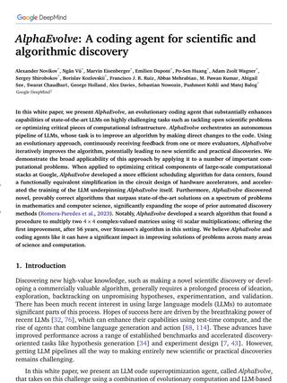AlphaEvolve</button>
<button type="button" class="fav-chip fav-chip--page" data-paper="2507.19457" aria-pressed="false">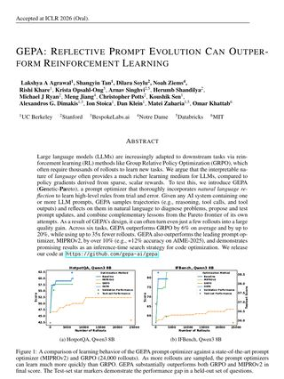GEPA</button>
<button type="button" class="fav-chip fav-chip--page" data-paper="2509.19349" aria-pressed="false">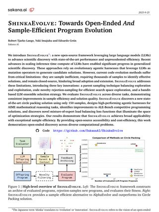ShinkaEvolve</button>
<button type="button" class="fav-chip fav-chip--page" data-paper="2510.26144" aria-pressed="false">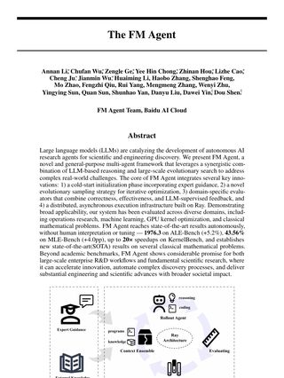The FM Agent</button>
<button type="button" class="fav-chip fav-chip--page" data-paper="2511.23473" aria-pressed="false">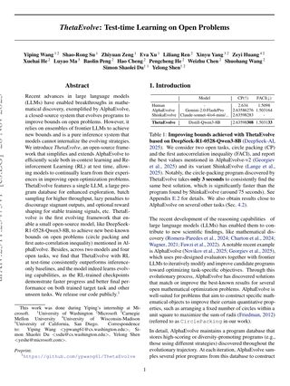ThetaEvolve</button>
<button type="button" class="fav-chip fav-chip--page" data-paper="2601.10657" aria-pressed="false">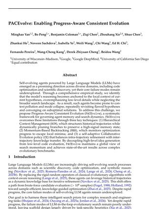PACEvolve</button>
<button type="button" class="fav-chip fav-chip--page" data-paper="2602.02919" aria-pressed="false">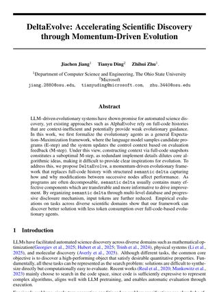DeltaEvolve</button>
<button type="button" class="fav-chip fav-chip--page" data-paper="2602.20133" aria-pressed="false">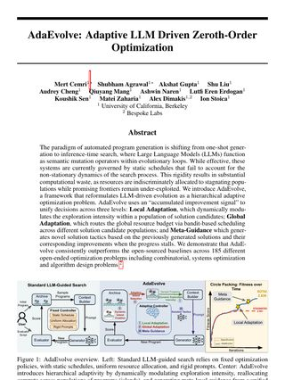AdaEvolve</button>
<button type="button" class="fav-chip fav-chip--page" data-paper="2602.23413" aria-pressed="false">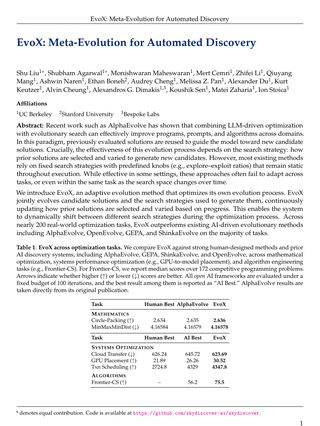EvoX</button>
<button type="button" class="fav-chip fav-chip--page" data-paper="2603.26499" aria-pressed="false">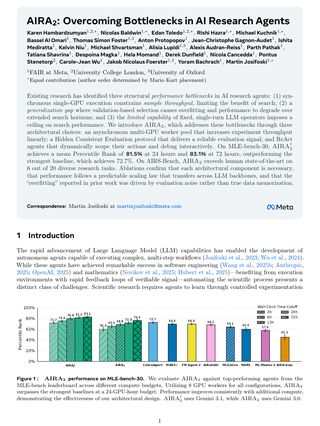AIRA₂</button>
<button type="button" class="fav-chip fav-chip--page" data-paper="2603.28052" aria-pressed="false">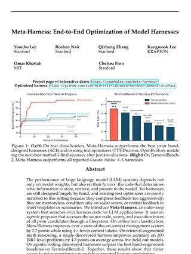Meta-Harness</button>
<button type="button" class="fav-chip fav-chip--page" data-paper="2603.29640" aria-pressed="false">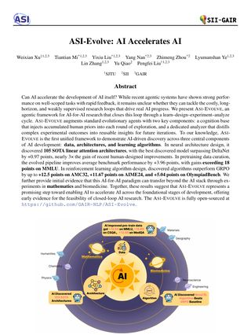ASI-Evolve</button>
<button type="button" class="fav-chip fav-chip--page" data-paper="2604.11556" aria-pressed="false">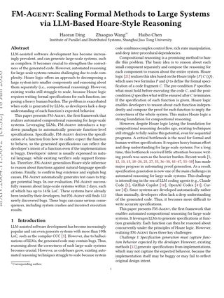FM-Agent</button>
<button type="button" class="fav-chip fav-chip--page" data-paper="2604.14455" aria-pressed="false">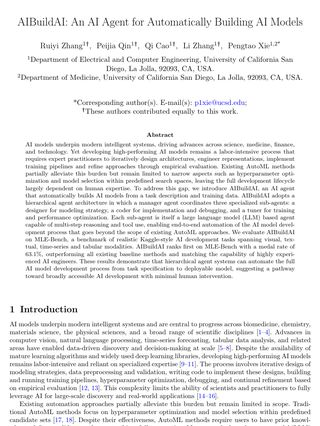AIBuildAI</button>
<button type="button" class="fav-chip fav-chip--page" data-paper="2605.07039" aria-pressed="false">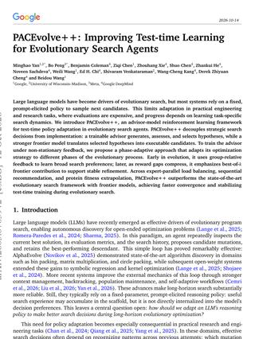PACEvolve++</button>
<button type="button" class="fav-chip fav-chip--page" data-paper="2606.06473" aria-pressed="false">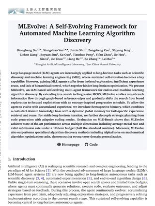MLEvolve</button>

<template data-card="2506.13131">

<a href="https://arxiv.org/abs/2506.13131" target="_blank" rel="noopener noreferrer">AlphaEvolve</a> Novikov et al. 2025

The evolutionary coding agent most of this field builds on. LLMs edit the code, evaluators score it, and the best programs seed the next round.

</template>
<template data-card="2507.19457">

<a href="https://arxiv.org/abs/2507.19457" target="_blank" rel="noopener noreferrer">GEPA</a> Agrawal et al. 2025

Evolves prompts instead of programs, reflecting on traces in plain language, and beats RL fine-tuning with far fewer rollouts.

</template>
<template data-card="2509.19349">

<a href="https://arxiv.org/abs/2509.19349" target="_blank" rel="noopener noreferrer">ShinkaEvolve</a> Lange et al. 2025

An open-source take aimed at sample efficiency, with smarter parent selection, rejecting near-duplicate candidates before they run, and choosing which LLM to ask. Its novelty filter is where my novelty gate started.

</template>
<template data-card="2510.26144">

<a href="https://arxiv.org/abs/2510.26144" target="_blank" rel="noopener noreferrer">The FM Agent</a> Li et al. 2025

A multi-agent framework pairing LLM reasoning with large-scale evolutionary search, with an expert-guided cold start.

</template>
<template data-card="2511.23473">

<a href="https://arxiv.org/abs/2511.23473" target="_blank" rel="noopener noreferrer">ThetaEvolve</a> Wang et al. 2025

An open-source, simplified AlphaEvolve that scales both in-context learning and reinforcement learning at test time.

</template>
<template data-card="2601.10657">

<a href="https://arxiv.org/abs/2601.10657" target="_blank" rel="noopener noreferrer">PACEvolve</a> Yan et al. 2026

A study of why evolving agents fail. The model anchors on its current hypothesis, the context fills with noise, and the search collapses onto one mode.

</template>
<template data-card="2602.02919">

<a href="https://arxiv.org/abs/2602.02919" target="_blank" rel="noopener noreferrer">DeltaEvolve</a> Jiang et al. 2026

Feeds the model structured notes on what changed between programs and why it moved the score, instead of whole code histories.

</template>
<template data-card="2602.20133">

<a href="https://arxiv.org/abs/2602.20133" target="_blank" rel="noopener noreferrer">AdaEvolve</a> Cemri et al. 2026

Replaces fixed schedules with adaptive ones, so compute stops going to populations that have stopped improving.

</template>
<template data-card="2602.23413">

<a href="https://arxiv.org/abs/2602.23413" target="_blank" rel="noopener noreferrer">EvoX</a> Liu et al. 2026

Evolves the search strategy itself, meaning how parents are picked and varied, not just the solutions.

</template>
<template data-card="2603.26499">

<a href="https://arxiv.org/abs/2603.26499" target="_blank" rel="noopener noreferrer">AIRA₂</a> Hambardzumyan et al. 2026

Meta&#x27;s AI research agent, built around three fixes. Experiments run asynchronously across many GPUs, a hidden and consistent evaluation keeps selection from overfitting, and ReAct agents replace single-turn LLM calls.

</template>
<template data-card="2603.28052">

<a href="https://arxiv.org/abs/2603.28052" target="_blank" rel="noopener noreferrer">Meta-Harness</a> Lee et al. 2026

Searches over the harness instead of the model, meaning the code that decides what an LLM stores, retrieves and sees.

</template>
<template data-card="2603.29640">

<a href="https://arxiv.org/abs/2603.29640" target="_blank" rel="noopener noreferrer">ASI-Evolve</a> Xu et al. 2026

An evolutionary agent for AI research with a learn, design, experiment, analyze cycle, a store of prior knowledge, and an analyzer that turns logs into lessons. The closest relative of Darwin&#x27;s engine.

</template>
<template data-card="2604.11556">

<a href="https://arxiv.org/abs/2604.11556" target="_blank" rel="noopener noreferrer">FM-Agent</a> Ding et al. 2026

Uses LLMs to write each function&#x27;s specification from how its callers expect it to behave, so large generated systems can be verified one component at a time with Hoare-style reasoning.

</template>
<template data-card="2604.14455">

<a href="https://arxiv.org/abs/2604.14455" target="_blank" rel="noopener noreferrer">AIBuildAI</a> Zhang et al. 2026

An agent that builds whole AI models, from architecture to training pipeline, instead of only tuning hyperparameters like AutoML.

</template>
<template data-card="2605.07039">

<a href="https://arxiv.org/abs/2605.07039" target="_blank" rel="noopener noreferrer">PACEvolve++</a> Yan et al. 2026

Trains a separate advisor model at test time to make the strategic search decisions, leaving the implementation to the main model.

</template>
<template data-card="2606.06473">

<a href="https://arxiv.org/abs/2606.06473" target="_blank" rel="noopener noreferrer">MLEvolve</a> Du et al. 2026

A multi-agent system for machine learning engineering that branches its search and pulls the best of each branch back together. I read the aggregation step closely, because synthesis spawn is built on it.

</template>

### Going Full-Time

The pace changed a lot when I moved to San Francisco and switched to full-time. Working on-site with a small team, in the same room as the people building the rest of the system, is a different speed than checking in part-time. Over the internship, it added up to the numbers below.

148

Pull requests merged

125.8K+

Lines added

22.9K−

Lines removed

437

Authored commits

### The Stack I Worked Across

Languages

RustTypeScriptPythonSQL

Backend

axumsqlxNestJSDrizzlePostgreSQLpgvectorRabbitMQ

Frontend

Next.jsReactRechartsReact Three Fiber

Research &amp; retrieval

Voyage embeddingsDoclingSemantic ScholarOpenAlex

ML &amp; robotics

PyTorchLeRobotSmolVLAπ0.5 (openpi)Isaac SimHugging Face

Infra

GCPCloud RunCloud SQLCloud StorageTerraformSkyPilotDocker

### What I Took Away

A few things stuck with me.

Evaluation is the whole game. The search optimizes exactly what you measure, loopholes included, as circle packing showed. Once you accept that, you start treating the measurement itself as the thing to protect.

The hard part of an automated researcher is not generating ideas. Getting an agent to propose something is easy. Getting it to not repeat itself, to know what has already been tried, and to tell a real improvement from a lucky score is where the actual work is.

It's also worth being honest about where this goes. Point the same loop at the training algorithms, architectures, and AI agents that build these systems, and you get AI improving AI itself, which is called **recursive self-improvement (RSI)**. That is the most exciting direction this work can take and probably the most dangerous, and it's why I think getting the measurement right matters so much.

I got to work on a genuinely ambitious version of automating research, and I came away more convinced that this line of work is going somewhere. Thank you to the team for the trust and the ownership. I'm excited to see what they build next in robotics.

### References

[1] Turing. "Computing Machinery and Intelligence." Mind 59(236), 1950. [doi:10.1093/mind/LIX.236.433](https://doi.org/10.1093/mind/LIX.236.433)

[2] Bäck, Hammel, Schwefel. "Evolutionary Computation: Comments on the History and Current State." IEEE Transactions on Evolutionary Computation 1(1), 1997. [doi:10.1109/4235.585888](https://doi.org/10.1109/4235.585888)

[3] Novikov et al. "AlphaEvolve: A coding agent for scientific and algorithmic discovery." 2025. [arXiv:2506.13131](https://arxiv.org/abs/2506.13131)

[4] Georgiev, Gómez-Serrano, Tao, Wagner. "Mathematical exploration and discovery at scale." 2025. [arXiv:2511.02864](https://arxiv.org/abs/2511.02864)

[5] Lange, Imajuku, Cetin. "ShinkaEvolve: Towards Open-Ended and Sample-Efficient Program Evolution." 2025. [arXiv:2509.19349](https://arxiv.org/abs/2509.19349)

[6] Sharma. "OpenEvolve: an open-source implementation of AlphaEvolve." 2025. [GitHub](https://github.com/algorithmicsuperintelligence/openevolve)

[7] Agrawal, Tan, Soylu, et al. "GEPA: Reflective Prompt Evolution Can Outperform Reinforcement Learning." 2025. [arXiv:2507.19457](https://arxiv.org/abs/2507.19457)

[8] Cemri et al. "AdaEvolve: Adaptive LLM Driven Zeroth-Order Optimization." 2026. [arXiv:2602.20133](https://arxiv.org/abs/2602.20133)

[9] Du, Yan, Shi, et al. "MLEvolve: A Self-Evolving Framework for Automated Machine Learning Algorithm Discovery." 2026. [arXiv:2606.06473](https://arxiv.org/abs/2606.06473)

[10] Xu, Mi, Liu, et al. "ASI-Evolve: AI Accelerates AI." 2026. [arXiv:2603.29640](https://arxiv.org/abs/2603.29640)

[11] Li et al. "The FM Agent." 2025. [arXiv:2510.26144](https://arxiv.org/abs/2510.26144)

[12] Stanley, Miikkulainen. "Evolving Neural Networks through Augmenting Topologies." Evolutionary Computation 10(2), 2002. [doi:10.1162/106365602320169811](https://doi.org/10.1162/106365602320169811)

[13] Anthropic. "How we built our multi-agent research system." 2025. [anthropic.com](https://www.anthropic.com/engineering/multi-agent-research-system)

[14] Ajith et al. "LitSearch: A Retrieval Benchmark for Scientific Literature Search." 2024. [arXiv:2407.18940](https://arxiv.org/abs/2407.18940)

[15] IOAI. "What happens when autonomous AI takes on the same tasks as the world's top young AI talents?" [ioai-official.org](https://ioai-official.org/what-happens-when-autonomous-ai-takes-on-the-same-tasks-as-the-worlds-top-young-ai-talents/)

[16] IOAI. "IOAI² Inaugural Edition Review: Autonomous AI Meets the International Olympiad in AI Challenge." 2026. [ioai-official.org](https://ioai-official.org/wp-content/uploads/2026/09/IOAI%C2%B2-AI-Models-Track_updated.pdf)
